# CrazyCraft 5.0 v2.0: what's new since v1.4.2

**[Português (Brasil)](CHANGELOG-2.0.pt-BR.md)**

CrazyCraft 5.0 v2.0 brings a story to the pack. *The Spilled Hoard* gives the Land its own calendar, its own paperwork
and its own people: you hatch on Shelf 9, the Prince writes to you, gold falls from the sky at night, a captain posts
bounties every Monday, a bar owner tells your deeds back to you bigger every Saturday, and the court's old bosses doze at
their posts until you walk in. Alongside the story come two Plants & Zombies updates, a round of balance and bug fixes
across the pack, and a look at the next OreSpawn update.

This page covers everything from the stable **v1.4.2** to **v2.0.0-alpha.5**, the five alpha releases on the
[releases page](https://github.com/CoolFreeze23/CrazyCraft-5.0/releases). Every picture and animation below is taken
in the game: the pack as v2.0.0-alpha.5 ships it, and for the OreSpawn armour, the next OreSpawn update on its own.

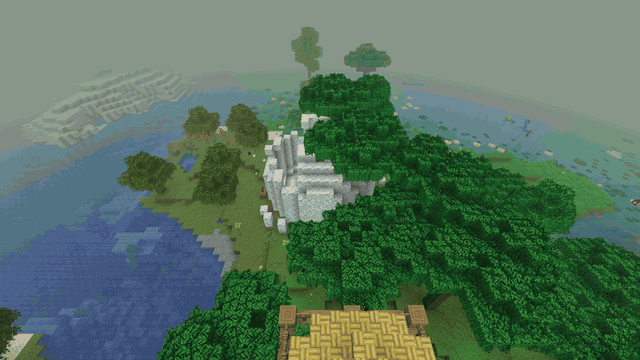

| Release | Date | What it brought |
|---|---|---|
| [v2.0.0-alpha.1](https://github.com/CoolFreeze23/CrazyCraft-5.0/releases/tag/v2.0.0-alpha.1) | 31 Oct 2026 | *The Spilled Hoard*, part 1: the First Hour. Randomizer removed, balance and fixes |
| [v2.0.0-alpha.2](https://github.com/CoolFreeze23/CrazyCraft-5.0/releases/tag/v2.0.0-alpha.2) | 1 Nov 2026 | Plants & Zombies 1.5.2 |
| [v2.0.0-alpha.3](https://github.com/CoolFreeze23/CrazyCraft-5.0/releases/tag/v2.0.0-alpha.3) | 7 Nov 2026 | Plants & Zombies 1.5.2-neoforge.2 |
| [v2.0.0-alpha.4](https://github.com/CoolFreeze23/CrazyCraft-5.0/releases/tag/v2.0.0-alpha.4) | 7 Nov 2026 | Part 2: the First Night and Week |
| [v2.0.0-alpha.5](https://github.com/CoolFreeze23/CrazyCraft-5.0/releases/tag/v2.0.0-alpha.5) | 7 Nov 2026 | Part 3: the Provinces and the Empty Court |

**These are alpha releases.** The stable release is still v1.4.2, and the setup program and the in-game update check
keep offering it. Back up your worlds before you try an alpha (see [Your worlds](#your-worlds)).

---

## Contents

- [The Spilled Hoard, part 1: the First Hour](#the-spilled-hoard-part-1-the-first-hour)
- [Part 2: the First Night and Week](#part-2-the-first-night-and-week)
- [Part 3: the Provinces and the Empty Court](#part-3-the-provinces-and-the-empty-court)
- [Plants & Zombies](#plants--zombies)
- [Coming next in OreSpawn](#coming-next-in-orespawn)
- [Pack changes](#pack-changes)
- [Your worlds](#your-worlds)
- [Known issues](#known-issues)
- [Downloads](#downloads)

---

## The Spilled Hoard, part 1: the First Hour

*v2.0.0-alpha.1, OreSpawn Integrations 0.10.0*

A new player wakes up on Shelf 9 holding one thing, and the first hour comes one step at a time, never two steps within
90 seconds, so nobody is buried in books and pop-ups.

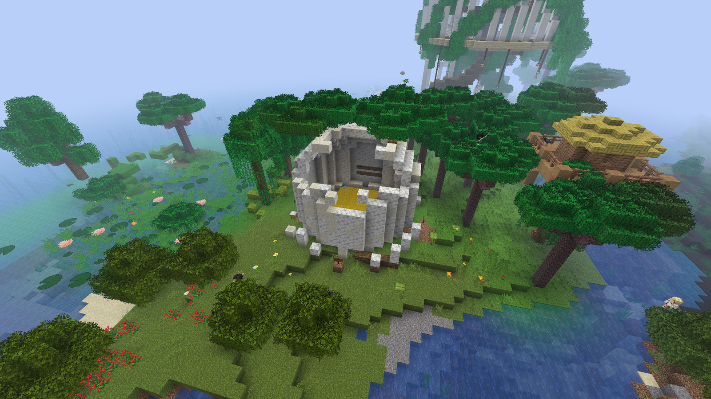

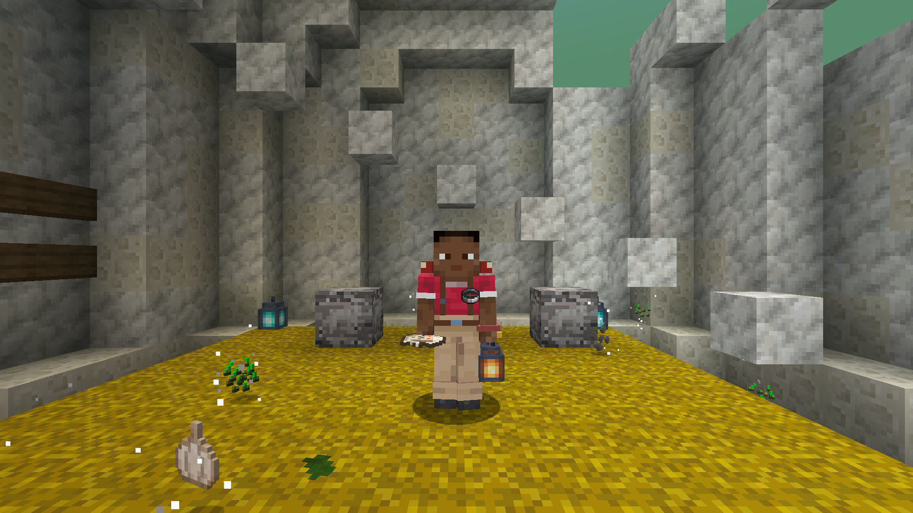

- **Shelf 9, the Hatching Ground.** It stands at a new world's spawn. You wake on its straw, and your name goes into
  the Hatch Register on its wall. Its Four Ways signs point to a real village, henge, tower and tavern nearby, each with
  the Prince's comment. On a server, an operator places it with `/cc hatching_ground place`.
- **Your Eggshell.** It opens into the Hoard Field Guide, a Royal Casket, a red bed, 6 torches and 3 cheese breads, and
  the Egged cap goes to your Wardrobe.
- **The Prince's Letter.** About five minutes in, the Prince flies over low and drops the Royal Summons at your feet,
  indoors too. Its postscript knows which origin you picked.
- **The First Fall.** A gold star whistles down nearby, with coins to punch and a crate addressed to you. Then **the
  Field Odete** walks up, opens your file and hands you the Field Notebook.
- **Region names.** Crossing into a new region shows its name, and your first visit pays a Ledger Scrap.
- **Royal Caskets, Ledger Scraps and Corrections.** The lucky blocks became Royal Caskets with their own tables by rank,
  and scraps buy Corrections at the table.
- **The Registry.** Villages have Registry desks, and their clerks, the Odetes.
- **Already in the world before this update?** You get a late entry in the Hatch Register, your own Summons by air, and
  a Back-Dated Fall with its own notice.

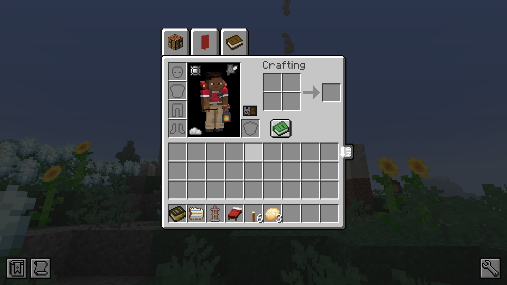

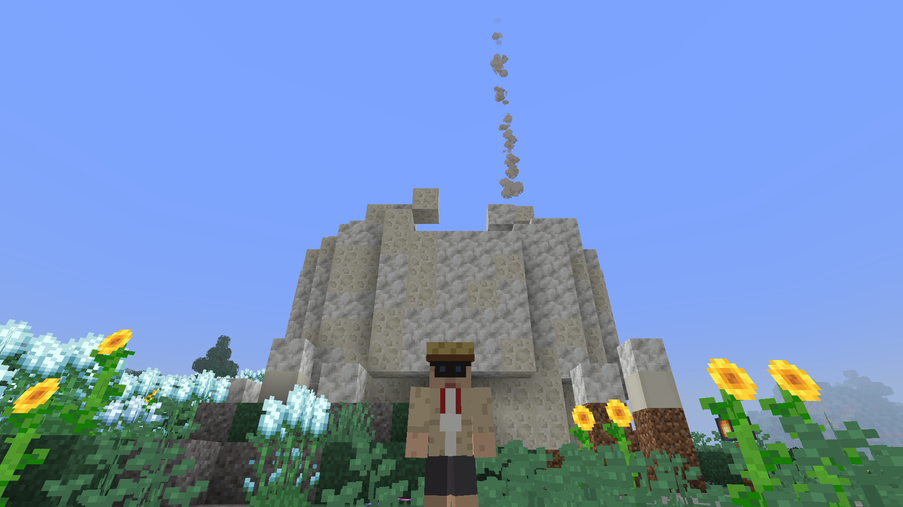

## Part 2: the First Night and Week

*v2.0.0-alpha.4, OreSpawn Integrations 0.10.1*

After the first hour comes the first night, and after it a week with a name for every day: a newspaper at dawn,
bounties on Monday, a peddler on Wednesday, stories at the bar on Saturday, and something in the woods on Sunday if you
hunted too much.

### The Hoard Fall

At night a Fall can come down near you: a warning 30 seconds ahead, a gold streak and a whistle, then a bowl of natural
ground with uranium and titanium in its walls, three Aliens around it, and a vault that grows with your rank. It digs no
holes in your base.

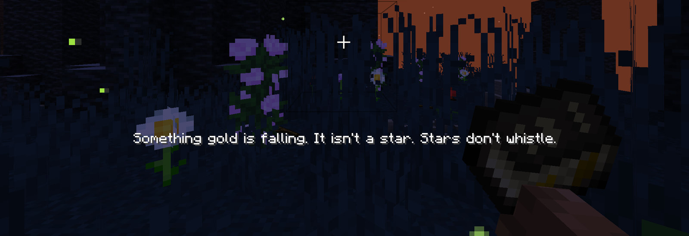

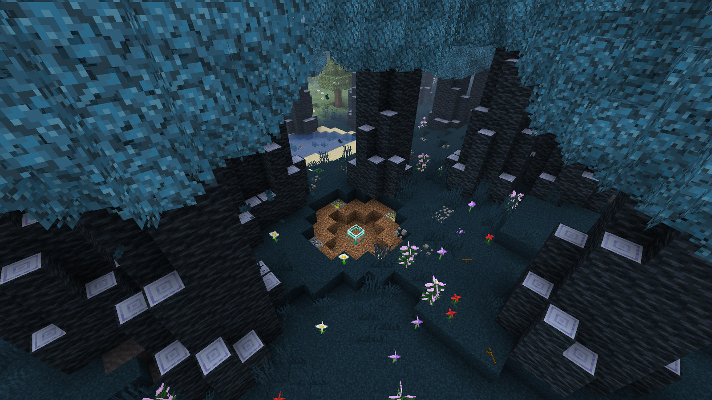

### The Hunt Lodge and the Wall of the Wanted

Every new world gets a Hunt Lodge 300 to 600 blocks from spawn, home of **Captain Iracema**. Her Wall of the Wanted
holds seven Wanted posters, and her board posts three bounties every Monday, one of them paid in Reais at triple pay.
On a world from before this version, the Monday board opens at any Monster Hunter tent and at the Registry desks.

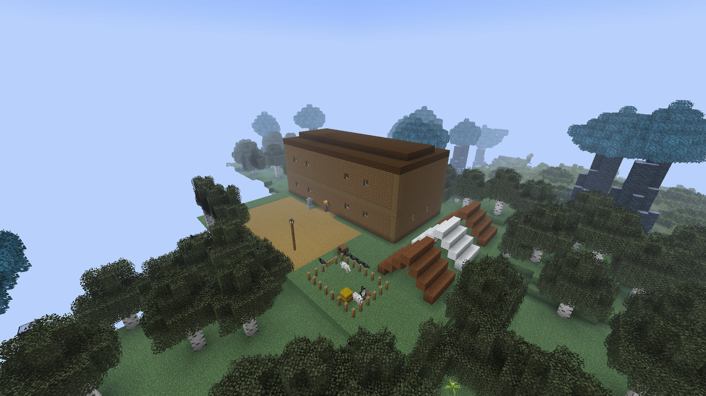

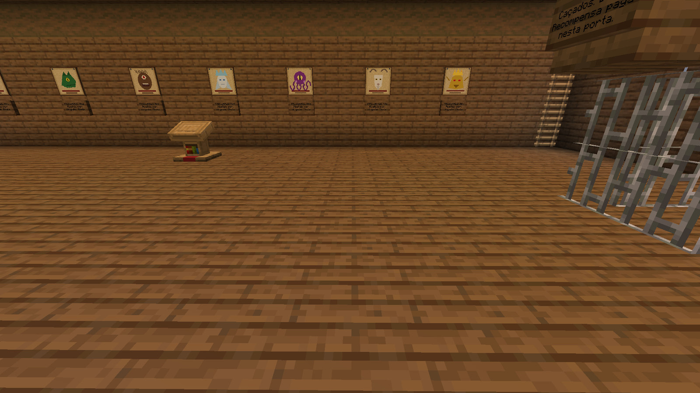

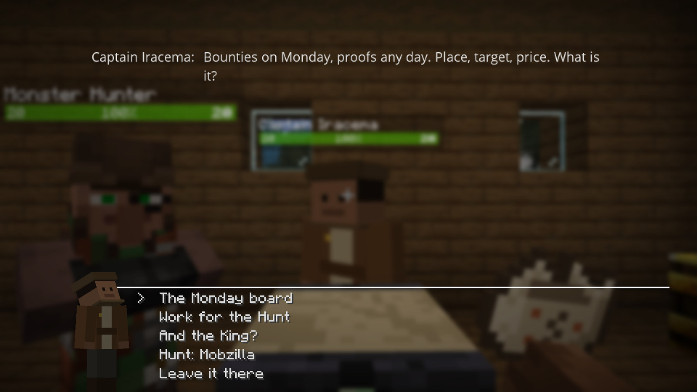

### Seu Zé's boteco and the Saturday retelling

A bar you can find in the Old Ground, the plains, the jungle and the savanna. The Land keeps a log of your deeds, and on
Saturday at dusk Seu Zé tells everyone at his counter their own deeds, each one a size bigger than it was.

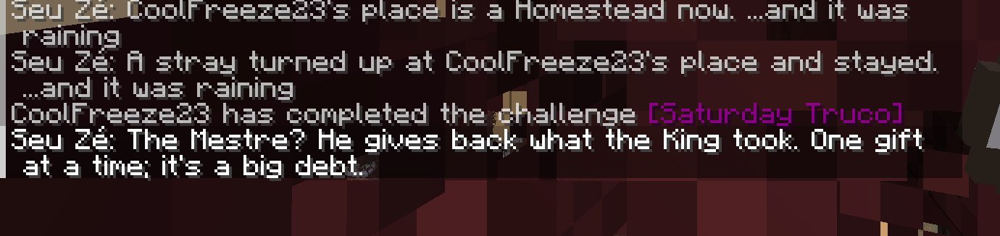

### Everything else in the week

- **The Land's Week.** The Land keeps its own day count, and the sunrise names the weekday. In your first week each new
  thing is explained one a day, not all at once.
- **The Almanac.** One event a night. Thursday and Friday nights stay for the Land's own business.
- **The Mãe-da-lua.** One line at dusk, and the urutau spawns at last in the Old Ground and the Greenwood.
- **The Interregnum Gazette.** A newspaper every dawn in your own language, with yesterday's biggest deed, Today's
  Misfile, the forecast and the classifieds.
- **Today's Misfile.** Each day the canopy can change: Fish in the Trees, Raining Hats, a Tuesday with almost nothing.
  Breaking leaves can drop a misfiled OreSpawn creature, gently, under Slow Falling.
- **Wednesday's peddler.** A trader and two llamas come to a newcomer's bed in their first week, or else to the week's
  best-kept house.
- **The Mapinguari's Sunday.** Hunt the Land's animals away from home on a Sunday and you get a warning at the second
  kill. The third brings the Mapinguari at dusk. Three raw meats send him back to the woods.
- **The Parish Stone and the Plot Stake.** A stone counts what you build near it, through four stages, with arrivals at
  dawn and plots to sign.
- **Court ranks.** Your rank is the same everywhere, and a rank-up grants every card you skipped in one ceremony.
  Players from before this version get theirs at their next login.
- **Jade** names Wanted posters, the Hunter's Workbench, the Parish Stone and the Land's animals.

## Part 3: the Provinces and the Empty Court

*v2.0.0-alpha.5, OreSpawn Integrations 0.10.2*

The Land's paperwork catches up with you, and the court's old bosses wait for you to walk in.

### The Nap

The arena's Mobzilla and the lair's Krakens doze at their posts. Walking onto the floor wakes them; sneaking past does
not. A hit on a dozing boss wakes it and does no damage, and a boss left alone goes back to its post at full health.

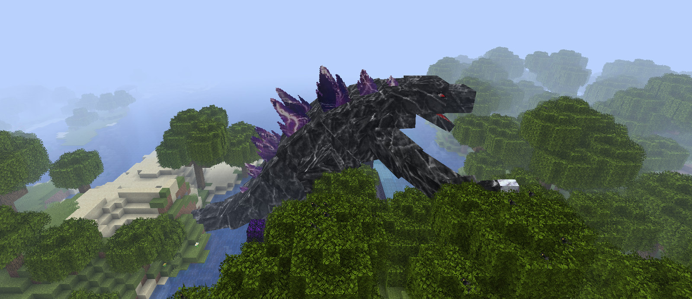

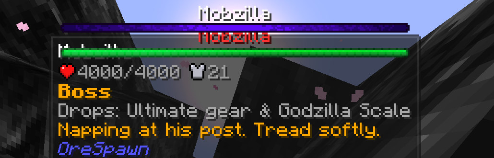

### The File

At your next Registry visit the desk opens a File in your name, and the papers you earn go into it.

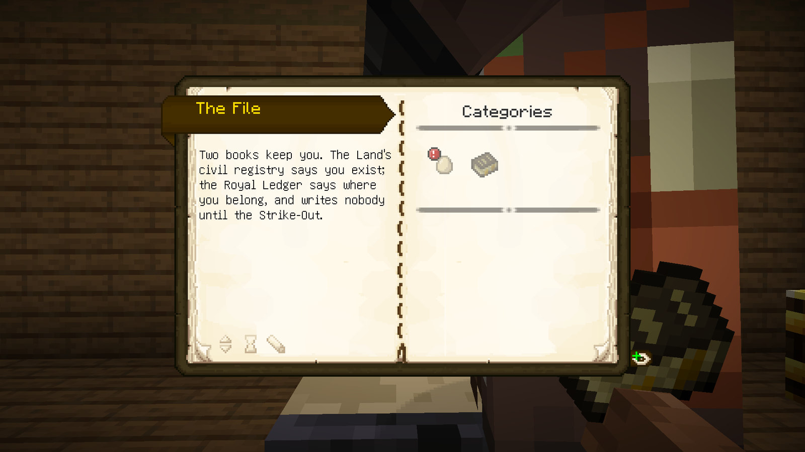

### Everything else in part 3

- **Visas and the Cloakroom.** The Mining, Village, Islands and Crystal gates ask for papers, and the desk issues the
  visas. The Cloakroom holds your belongings while you go.
- **Office Hours.** The Registry desks open in the morning and close at night and on weekends; after hours there is the
  priority desk.
- **The Lost Pages.** 25 pages of the old kingdom turn up in chests. Each one reveals something, the desk trades your
  first copies, and a binder holds the set.
- **Crater duty.** Report a Hoard Fall you saw land, during office hours, and the Field Odete pays for the report.
- **The Court Beasts and difficulty by place.** The court's beasts are worth a knighthood, with a vault key for each
  player who helped. The Mines, the Islands and Chaos make their monsters tougher.
- **Hallmarks.** Tools, weapons and armour show their place on the Land's ladder, from Make-Do to Off the Ledger.
- **Commissioned Tales and Tale Plaques.** Tales made to order, each ending kept on the Placar, and plaques that go up on
  free ground and grow on Saturday.
- **Who Comes for What You Have.** A rank-up can bring a Pretender's claim; the Odete answers it with you.
- **The Annexation.** On day 7 a letter arrives, and Vó Nena comes at dusk.

Full notes for each part: OreSpawn Integrations
[0.10.0](https://github.com/CoolFreeze23/orespawn-integrations/releases/tag/v0.10.0),
[0.10.1](https://github.com/CoolFreeze23/orespawn-integrations/releases/tag/v0.10.1) and
[0.10.2](https://github.com/CoolFreeze23/orespawn-integrations/releases/tag/v0.10.2).

## Plants & Zombies

*v2.0.0-alpha.2 and alpha.3: Plants & Zombies 1.5 to 1.5.2-neoforge.2, on client and server*

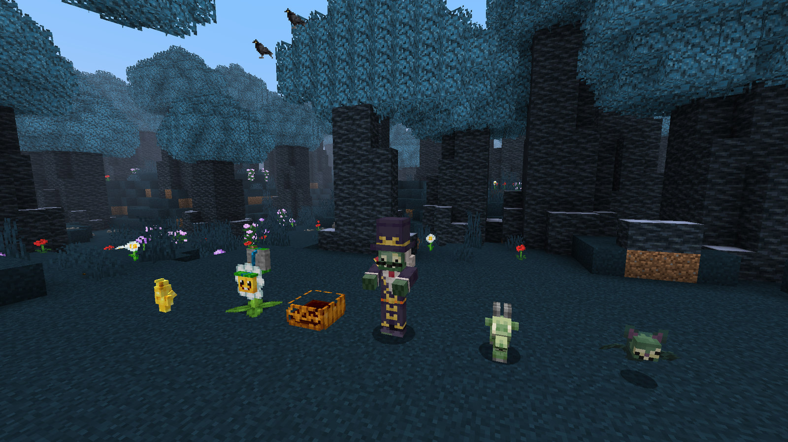

- **New plants:** the Pumpkin, and the Marigold, which drops loot instead of a seed packet.
- **New zombies:** the Zombie Goat, the flying Zombat, and Baron von Bats with his staff.
- **New gear:** the Coffin, worn to block direct attacks from any side, and the Door Shield, made from a shield and any
  door.
- **Raids** can bring a boss, with more boss types, a boss spawn sound and a new wave timer and overlay. The new `/pz`
  command has `help` and `options`, and for operators `raid start`, `stop` and `wave_start`.
- Also new: writable letters with attachments, Brainz alloy doors and trapdoors, the golden garden gnome, better head
  protection, newspaper blocking, the gardening glove's Lobbing enchantment and dye-blaster ammunition.
- The Plants vs. Zombies characters have their official Brazilian Portuguese names.
- Village guards fight the Zombat, the Zombie Goat and Baron von Bats, and Baron von Bats can't be caged in a Soul Cage.

## Coming next in OreSpawn

The pack runs OreSpawn 2.0.0-beta.15, the same as v1.4.2. The next OreSpawn update, **beta.16**, is finished and
comes to the pack in a later version:

- **New Modern armour for all 14 sets.** 3D pieces with each set's own details: the Queen's tiara and scaled mantle,
  the Royal Guardian's crown, collar and cape, Mobzilla's dorsal plates and claws, Ultimate's swept wings and core gem,
  Tiger's Eye's ears and claws, Crystal Pink's shards, Moth Scale's antennae and folded wings, the Lava Eel's fins and
  glowing seams, the Peacock's crest and feather fan. New textures, new inventory icons, and matching horse, wolf and dog
  armour. Choose Modern or Classic in the OreSpawn Visuals screen (O by default); Classic is unchanged.
- **The Gamma Metroid's shell** no longer has a hole on its right side.

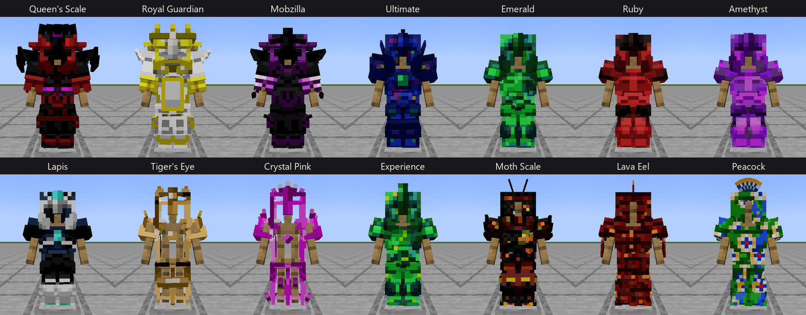

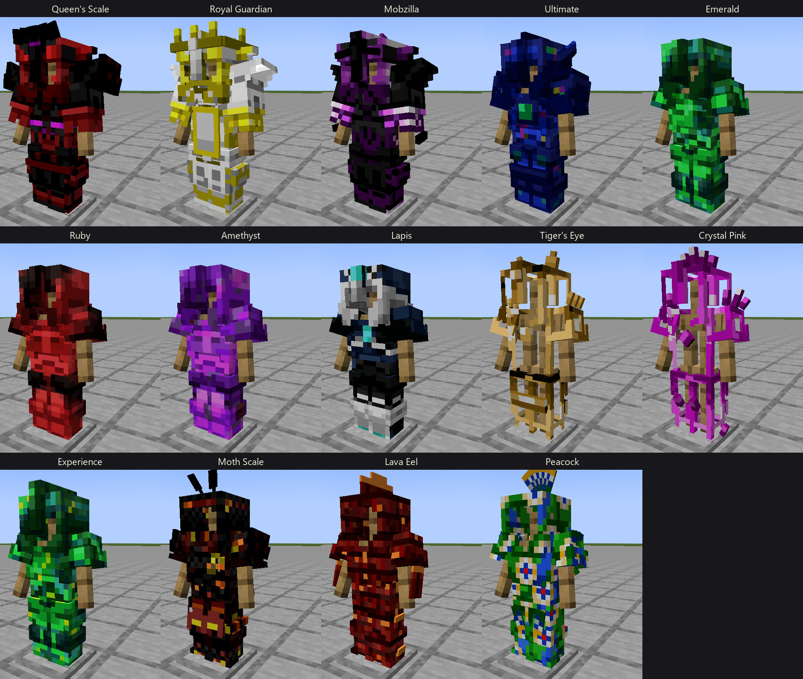

Full notes: the [OreSpawn changelog](https://github.com/CoolFreeze23/Orespawn/blob/master/CHANGELOG.md).

## Pack changes

**Removed**
- Randomizer: Complete Edition. Updating moves its jar to `mods-removed/`; nothing is deleted.

**Balance**
- Soul Cages refuse bosses.
- Breaking coal ore no longer releases HBM's coal dust.
- Umvuthi and the Sculptor ask fairer prices.
- The Duplicator Tree no longer copies blocks.
- Drifting islands move at half speed.
- Pandora's Box no longer spawns the Wither, and its void is 6 to 10 blocks wide.
- Pets near you travel with you through waystones.
- Village guards also fight OreSpawn's robots and the Plants & Zombies zombies.
- A hostile shape from Walkers no longer makes every hostile mob leave you alone.

**Fixes**
- A Royal Casket's trap no longer burns or breaks a roof; its blasts hurt only the players nearby.
- The game no longer crashes in the creative inventory with Refurbished Furniture.
- Long region names and subtitles no longer run off the screen at small GUI scales.
- A fresh install opens straight to the title screen; the narrator choice stays in the options menu.
- The launch no longer fails on a resource pack with special characters in its name, and the Redstone Torch pack
  appears once.
- Jade no longer gives the Mimic away.
- Ars Nouveau no longer puts its book in your inventory every time you join.
- Journey's End counts only a Dragon killed in the End.
- The extra minimap in the corner is gone.

**Text**
- The title screen tagline, "the throne is empty", is in your language, and the language button is back.
- Godzilla is now Mobzilla, and the Simple Lucky Block is the Sealed Casket.
- Many Brazilian Portuguese names are corrected.

**Installing and updating**
- An alpha install is told when the full 2.0.0 is out, and sees no banner for v1.4.2.
- Updates move what the pack replaces to `mods-removed/`, and leave your own extra mods where they are.
- A renamed resource pack keeps its place in your pack list.

**Unchanged since v1.4.2:** OreSpawn 2.0.0-beta.15, Domestication Innovation 2.1.0, Origin Awakening 1.0.0, VRAM Leak
Fixes 1.0.0, OreSpawn Delight 0.1.0 and NeoForge 21.1.252. Controller support isn't in these alphas yet. The pack has 211
mods (168 on the server) and 29 resource packs.

## Your worlds

**Back up first.** Copy your `saves/` folder (or the server's world folder) somewhere safe before you open a world in an
alpha.

**Servers and players update together.** OreSpawn Integrations and Plants & Zombies run on both sides, so an alpha client
can't join a v1.4.x server, and the other way round. The hub server still runs v1.4.x.

**Only in land you haven't explored yet:**
- Shelf 9 is placed when a new world is created. On an older world an operator can place it with
  `/cc hatching_ground place`.
- The Hunt Lodge is placed on a new world's first start. An older world uses the Monster Hunter tents and the Registry
  desks for the Monday board, or an operator places a Lodge with `/cc hunt_lodge place`.
- Seu Zé's boteco turns up in new land.
- Plants & Zombies' graveyards turn up in new land.

**In the land you've already explored, as soon as you load it:**
- Recipes, drops and never-opened chests are vanilla again without Randomizer. A Lootr chest you already opened keeps
  what it gave you.
- Utopia stops spawning monsters everywhere, the Royal Mines lose their Ender Knights, Ender Reapers and Mothra, and
  drifting islands stop spawning in the Islands.
- Lost Pages turn up in chests you haven't opened yet.
- Mobzilla and the Krakens in arenas and lairs you've already found start dozing the next time they load.

**Your character:**
- Players who were already in the world get a late entry in the Hatch Register, the Summons by air and a Back-Dated
  Fall.
- Court ranks are backfilled at your next login, and your File opens at your next Registry visit.
- Zombie bats and their spawn eggs from an alpha.2 world are gone after alpha.3, because the mob has a new id. Spawn a
  Zombat instead.

## Known issues

- Creating a first world can take up to about a minute on a handheld, while Shelf 9 and the Hunt Lodge look for a
  place to stand.
- A world with no fitting land within 192 blocks plays without Shelf 9. None of our 24 test worlds hit this, but it can
  happen.
- A world with no fitting land 300 to 600 blocks out has no Hunt Lodge; its Monday board is at the tents and desks.
- Bounty Reais aren't capped yet; the weekly limit comes in a later version.
- In this pack a Curupira can't break Distant Lands planks, and a Beaver can eat them.
- HBM's oil pockets can end flat at a chunk edge in new land (a logged warning, nothing else).
- If an operator sets a player's origins by command instead of the origin screen, that player can't be hurt until they
  log in again (Neo Origins' own behaviour).
- Not yet checked in alpha.5: the Ars Nouveau Place Block glyph against the court's floors, and Jade's warning on a
  royal tree's crown spawner.

## Downloads

Get them from the [v2.0.0-alpha.5 release](https://github.com/CoolFreeze23/CrazyCraft-5.0/releases/tag/v2.0.0-alpha.5).

- `CrazyCraft5-Client.zip`: the client pack. Import it into Prism Launcher or MultiMC (Add Instance, then Import) and
  give it 8 to 12 GB of RAM. The first launch downloads the mods from their official pages. MCHeli still has to be
  downloaded by hand.
- `CrazyCraft5-Server.zip`: the dedicated server files. Unzip them, then double-click `CrazyCraft Server Setup.bat`
  (Windows) or run `./startserver.sh` (Linux and macOS).

Tested before release: 190 GameTests on a test server and in the full pack, server boots of a new world and of worlds
from v1.4.x, alpha.1 and alpha.4, and a real client in Brazilian Portuguese on a handheld through the File, the visas,
the Cloakroom, the Lost Pages, office hours, hallmarks, the Annexation letter and the Nap.
