# CrazyCraft 5.0 v2.0: o que mudou desde a v1.4.2

**[English](CHANGELOG-2.0.md)**

A v2.0 traz uma história para o CrazyCraft 5.0. Em *O Tesouro Derramado*, a Terra ganha calendário, papelada e gente
própria: você choca na Prateleira 9, o Príncipe te escreve, cai ouro do céu de noite, uma capitã prega recompensas toda
segunda-feira, o dono do bar reconta os seus feitos maiores a cada sábado, e os velhos chefes da corte cochilam no posto
até você pisar na arena. Junto com a história vêm duas atualizações do Plants & Zombies, uma leva de ajustes e
correções no pack inteiro, suporte a controle e portáteis e uma prévia da próxima atualização do OreSpawn.

Esta página reúne tudo o que mudou da versão estável **v1.4.2** até a **v2.0.0-alpha.6**, as seis versões alfa da
[página de lançamentos](https://github.com/CoolFreeze23/CrazyCraft-5.0/releases). Todas as imagens e animações daqui
foram capturadas no jogo: o pack do jeito que a v2.0.0-alpha.6 o distribui e, nas armaduras do OreSpawn, a próxima
atualização do OreSpawn sozinha.

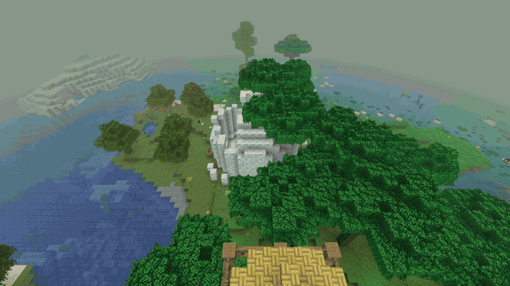

| Versão | Data | O que trouxe |
|---|---|---|
| [v2.0.0-alpha.1](https://github.com/CoolFreeze23/CrazyCraft-5.0/releases/tag/v2.0.0-alpha.1) | 31/10/2026 | *O Tesouro Derramado*, parte 1: a Primeira Hora. Saída do Randomizer, ajustes e correções |
| [v2.0.0-alpha.2](https://github.com/CoolFreeze23/CrazyCraft-5.0/releases/tag/v2.0.0-alpha.2) | 01/11/2026 | Plants & Zombies 1.5.2 |
| [v2.0.0-alpha.3](https://github.com/CoolFreeze23/CrazyCraft-5.0/releases/tag/v2.0.0-alpha.3) | 07/11/2026 | Plants & Zombies 1.5.2-neoforge.2 |
| [v2.0.0-alpha.4](https://github.com/CoolFreeze23/CrazyCraft-5.0/releases/tag/v2.0.0-alpha.4) | 07/11/2026 | Parte 2: a Primeira Noite e a Semana |
| [v2.0.0-alpha.5](https://github.com/CoolFreeze23/CrazyCraft-5.0/releases/tag/v2.0.0-alpha.5) | 07/11/2026 | Parte 3: as Províncias e a Corte Vazia |
| [v2.0.0-alpha.6](https://github.com/CoolFreeze23/CrazyCraft-5.0/releases/tag/v2.0.0-alpha.6) | 08/11/2026 | Suporte a controle, o OreSpawn mais novo |

**São versões alfa.** A versão estável continua sendo a v1.4.2, e é ela que o instalador e a verificação de
atualização do jogo oferecem. Faça backup dos seus mundos antes de testar uma alfa (veja [Seus mundos](#seus-mundos)).

---

## O que há de novo, num relance

- **Uma história para o pack.** *O Tesouro Derramado* começa no instante em que você choca na Prateleira 9 e segue pela
  primeira hora, pela primeira noite e por uma semana inteira no calendário da própria Terra.
  [Saiba mais](#o-tesouro-derramado-parte-1-a-primeira-hora)
- **Ouro que cai de noite.** As Quedas do Tesouro chegam com aviso, três Alienígenas e um cofre que cresce com o seu
  posto. [Saiba mais](#a-queda-do-tesouro)
- **Lugares e gente nova.** O Pavilhão de Caça da Capitã Iracema, com recompensas toda segunda, o boteco do Seu Zé, com
  causo todo sábado, e os Balcões do Registro, com o seu Processo. [Saiba mais](#o-pavilhão-de-caça-e-o-mural-dos-procurados)
- **Chefes cochilando.** O Mobzilla e os Krakens fazem a sesta no posto até você pisar na arena. [Saiba mais](#a-sesta)
- **Jogue com controle.** Rodas de ações, os poderes da origem num botão e uma ajuda que diz o que dá para fazer.
  [Saiba mais](#suporte-a-controle)
- **Mais Plants & Zombies.** Plantas novas, o Zumbi Morcego, a Cabra Zumbi, o Barão Von Morcego e invasões com chefe.
  [Saiba mais](#plants--zombies)
- **O OreSpawn mais novo.** Armaduras novas em 3D para os 14 conjuntos. [Saiba mais](#vem-aí-no-orespawn)
- **Ajustes e correções** no pack inteiro, e os seus mundos continuam. [Saiba mais](#mudanças-no-pack)

## Conteúdo

- [O que há de novo, num relance](#o-que-há-de-novo-num-relance)
- [O Tesouro Derramado, parte 1: a Primeira Hora](#o-tesouro-derramado-parte-1-a-primeira-hora)
- [Parte 2: a Primeira Noite e a Semana](#parte-2-a-primeira-noite-e-a-semana)
- [Parte 3: as Províncias e a Corte Vazia](#parte-3-as-províncias-e-a-corte-vazia)
- [Suporte a controle](#suporte-a-controle)
- [Plants & Zombies](#plants--zombies)
- [Vem aí no OreSpawn](#vem-aí-no-orespawn)
- [Mudanças no pack](#mudanças-no-pack)
- [Seus mundos](#seus-mundos)
- [Problemas conhecidos](#problemas-conhecidos)
- [Downloads](#downloads)

---

## O Tesouro Derramado, parte 1: a Primeira Hora

*v2.0.0-alpha.1, OreSpawn Integrations 0.10.0*

Quem chega acorda na Prateleira 9 segurando uma coisa só, e a primeira hora vem um passo de cada vez, nunca dois em
menos de 90 segundos. Ninguém é soterrado por livro e janela pulando na tela.

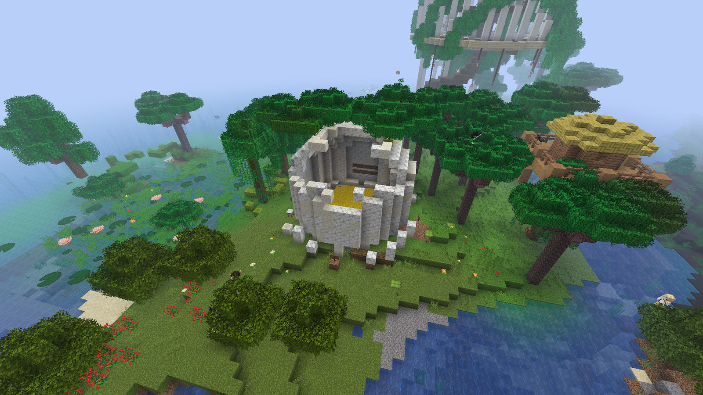

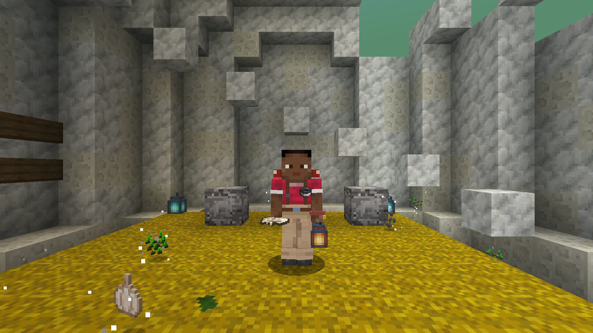

- **A Prateleira 9, o Ninho.** Ela fica no spawn de um mundo novo. Você acorda na palha, e o seu nome entra no Livro de
  Eclosões pendurado na parede. As placas dos Quatro Rumos apontam uma vila, um círculo de pedras, uma torre e uma
  taberna de verdade ali perto, cada uma com um comentário do Príncipe. Num servidor, um operador coloca a Prateleira
  com `/cc hatching_ground place`.
- **Sua Casca.** Ela abre e dá o Guia de Campo do Tesouro, uma Arca Real, uma cama vermelha, 6 tochas e 3 pães de
  queijo, e a touca Chocado vai para o seu Guarda-Roupa.
- **A Carta do Príncipe.** Lá pelos cinco minutos, o Príncipe passa voando baixo e larga a Convocação Real no seu pé,
  até dentro de casa. O pós-escrito sabe qual origem você escolheu.
- **A Primeira Queda.** Uma estrela dourada cai assobiando ali perto, com moedas para socar e um caixote no seu nome.
  Depois chega **a Odete de Campo**, abre a sua ficha e te entrega a Caderneta de Campo.
- **Nomes das regiões.** Entrar numa região nova mostra o nome dela, e a primeira visita paga um Retalho do
  Livro-Razão.
- **Arcas Reais, Retalhos e Emendas.** Os lucky blocks viraram Arcas Reais, com tabelas próprias para cada posto, e os
  retalhos compram Emendas na mesa.
- **O Cartório da Vila.** As vilas têm Balcões do Registro, com as atendentes, as Odetes.
- **Já estava no mundo antes desta atualização?** Você ganha uma entrada atrasada no Livro de Eclosões, a sua própria
  Convocação pelo ar e uma Queda Retroativa com aviso próprio.

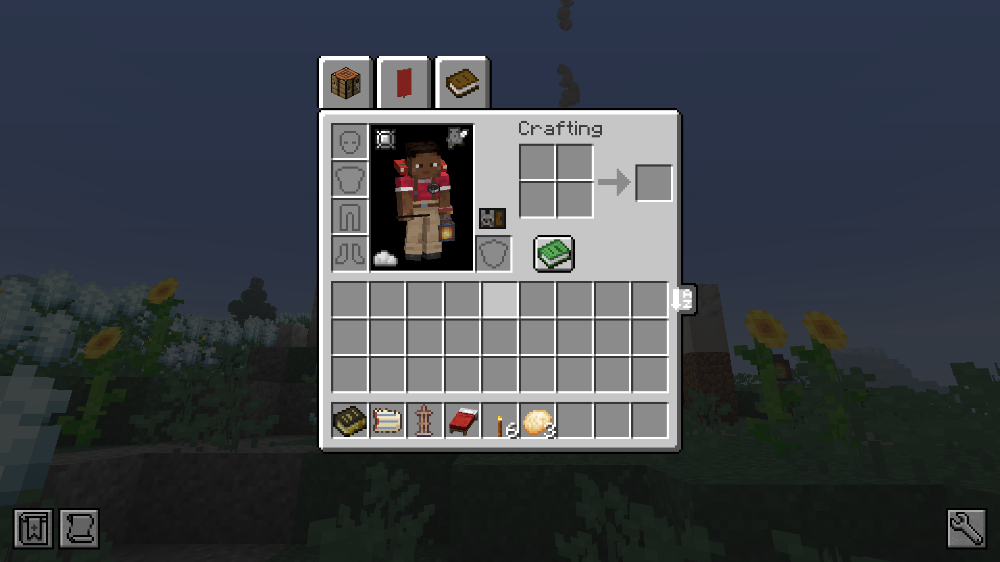

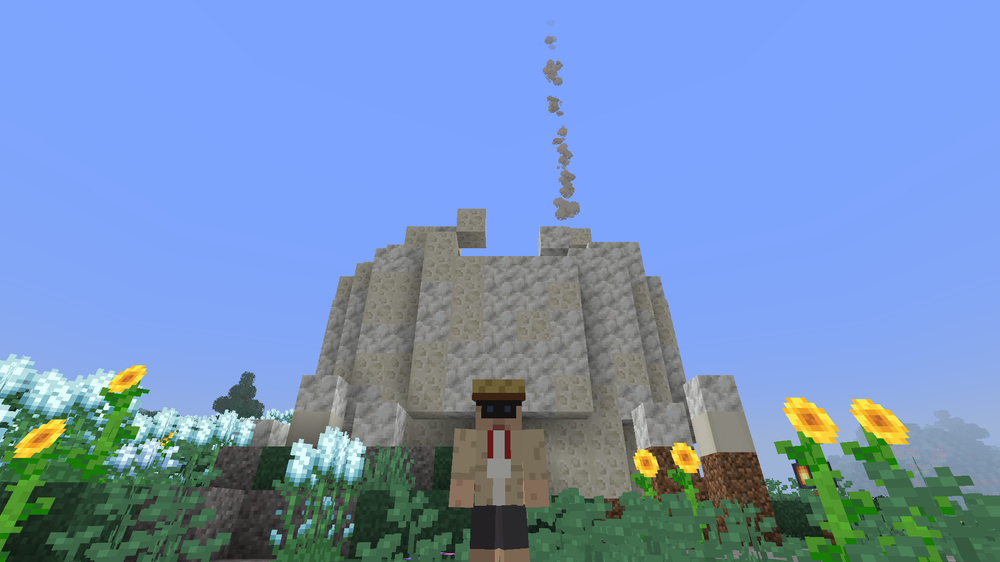

## Parte 2: a Primeira Noite e a Semana

*v2.0.0-alpha.4, OreSpawn Integrations 0.10.1*

Depois da primeira hora vem a primeira noite, e depois dela uma semana em que cada dia tem nome: jornal ao amanhecer,
recompensas na segunda, mascate na quarta, causo no bar no sábado, e alguma coisa no mato no domingo se você caçou
demais.

### A Queda do Tesouro

De noite pode cair uma Queda perto de você: um aviso 30 segundos antes, um rastro dourado e um assobio, e depois uma
cratera rasa de chão natural com urânio e titânio nas paredes, três Alienígenas em volta e um cofre que cresce com o seu
posto. Ela não abre buraco na sua base.

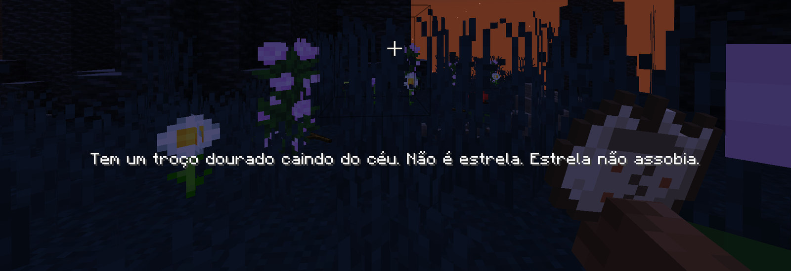

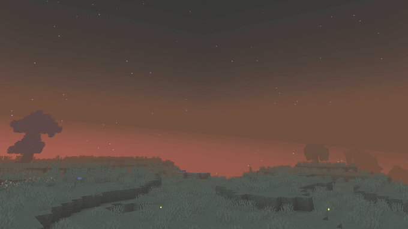

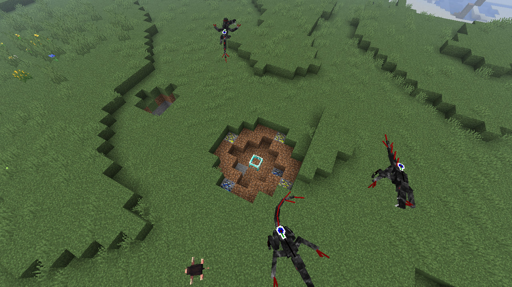

### O Pavilhão de Caça e o Mural dos Procurados

Todo mundo novo ganha um Pavilhão de Caça a 300–600 blocos do spawn, a casa da **Capitã Iracema**. No Mural dos
Procurados ficam sete cartazes de Procurado, e o quadro dela prega três recompensas toda segunda-feira, uma delas paga em
Reais, com valor triplo. Num mundo de antes desta versão, o quadro de segunda abre em qualquer tenda de Caçador de
Monstros e nos Balcões do Registro.

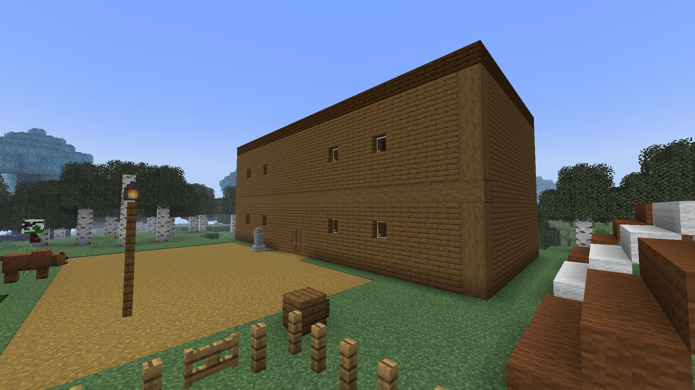

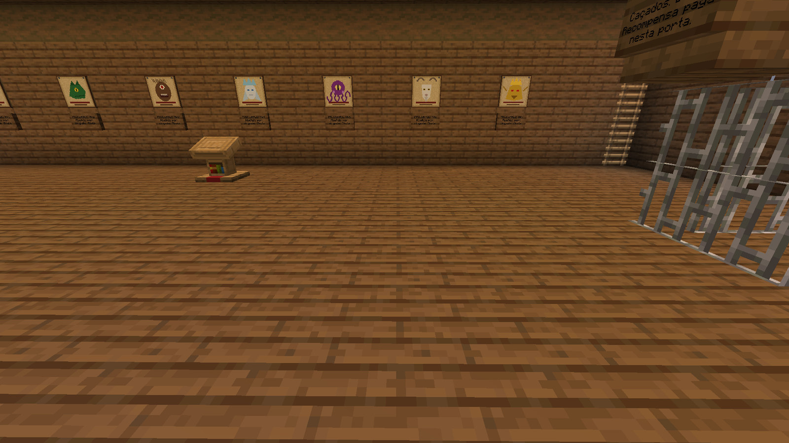

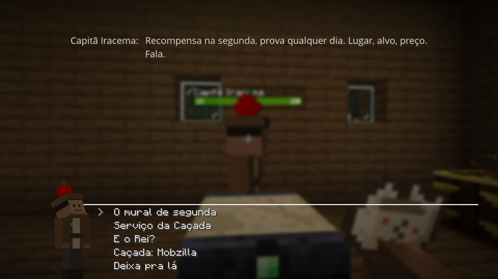

### O boteco do Seu Zé e o causo de sábado

Um bar que dá para achar no Chão Velho, nas planícies, na selva e na savana. A Terra anota os seus feitos, e no sábado
ao anoitecer o Seu Zé reconta para quem está no balcão os feitos de cada um, sempre um tamanho maior do que foram.

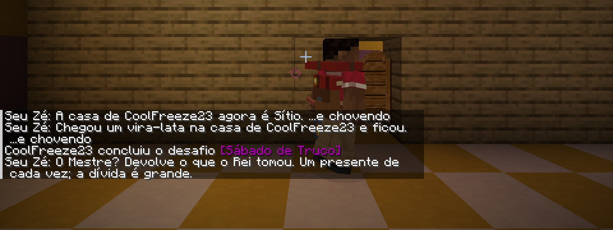

### O resto da semana

- **A Semana da Terra.** A Terra conta os próprios dias, e o nascer do sol diz o dia da semana. Na sua primeira semana,
  cada novidade é explicada uma por dia, não tudo de uma vez.
- **O Almanaque.** Um evento por noite. As noites de quinta e sexta ficam para os assuntos da própria Terra.
- **A mãe-da-lua.** Uma fala ao anoitecer, e o urutau finalmente aparece no Chão Velho e na Mata.
- **O Diário Oficial do Interregno.** Um jornal a cada amanhecer na sua língua, com o maior feito de ontem, o Extravio
  do dia, a previsão e os classificados.
- **O Extravio do dia.** A cada dia a copa das árvores pode mudar: Peixe no galho, Chuva de chapéu, uma terça em que
  quase nada acontece. Quebrar folhas pode derrubar uma criatura do OreSpawn extraviada, devagarinho, com Queda Lenta.
- **O mascate de quarta-feira.** Um mercador e duas lhamas vêm até a cama de um novato na primeira semana dele, ou então
  até a casa mais bem cuidada da semana.
- **O Domingo do Mapinguari.** Cace os animais da Terra longe de casa num domingo e você leva um aviso na segunda caça.
  A terceira traz o Mapinguari ao anoitecer. Três carnes cruas mandam ele de volta para o mato.
- **O Marco da Freguesia e a Estaca de Lote.** O marco conta o que você constrói perto dele, em quatro etapas, com gente
  chegando ao amanhecer e lotes para assinar.
- **Postos da corte.** Seu posto é o mesmo em todo lugar, e subir de posto entrega de uma vez, numa cerimônia só, todo
  card que você pulou. Quem já jogava antes desta versão recebe o seu no próximo login.
- **O Jade** mostra o nome dos cartazes de Procurado, da Bancada do Caçador, do Marco da Freguesia e dos animais da
  Terra.

## Parte 3: as Províncias e a Corte Vazia

*v2.0.0-alpha.5, OreSpawn Integrations 0.10.2*

A papelada da Terra te alcança, e os velhos chefes da corte ficam esperando você entrar.

### A Sesta

O Mobzilla da arena e os Krakens do covil fazem a sesta nos seus postos. Pisar na arena acorda o chefe; passar
agachado, não. Um golpe num chefe na sesta só o acorda, sem causar dano, e um chefe deixado em paz volta ao posto com a
vida cheia.

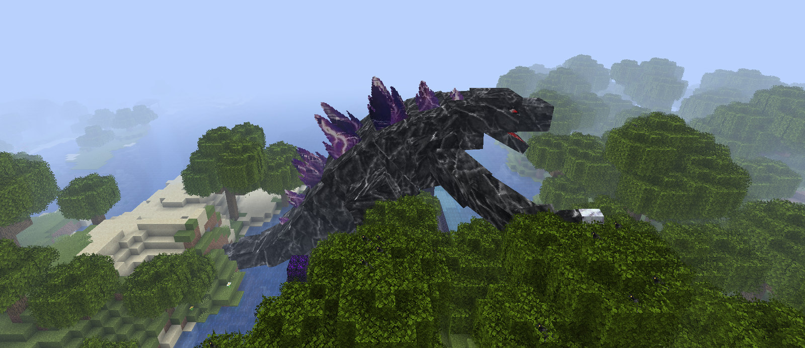

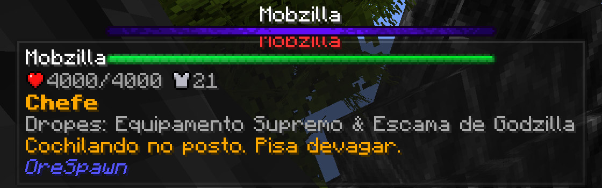

### O Processo

Na sua próxima visita ao Registro, o balcão abre um Processo no seu nome, e os papéis que você ganha vão para ele.

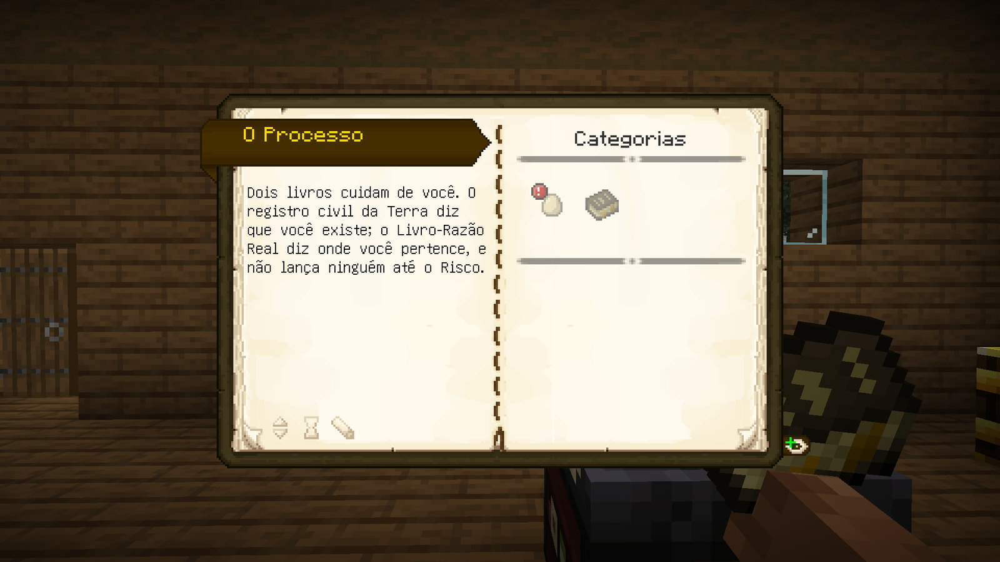

### O resto da parte 3

- **Vistos e a Chapelaria.** Os portões das Minas, da Vila, das Ilhas e do Cristal pedem papéis, e o balcão emite os
  vistos. A Chapelaria guarda os seus pertences enquanto você vai.
- **O Expediente.** Os balcões do Registro abrem de manhã e fecham à noite e nos fins de semana; fora do horário existe o
  Plantão Preferencial.
- **As Folhas Perdidas.** 25 folhas do antigo reino aparecem em baús. Cada uma revela alguma coisa, o balcão troca as
  suas primeiras cópias, e uma pasta guarda a coleção.
- **Plantão de cratera.** Relate uma Queda do Tesouro que você viu cair, no horário do expediente, e a Odete de Campo
  paga pelo relato.
- **As Feras da Corte e a dificuldade por lugar.** As feras da corte valem o título de cavaleiro, com uma chave do cofre
  para cada jogador que ajudou. As Minas, as Ilhas e o Caos deixam seus monstros mais fortes.
- **Contrastes.** Ferramentas, armas e armaduras mostram seu lugar na escada da Terra, de Gambiarra a Fora do Livro.
- **Causos de Encomenda e Placas de Causo.** Causos sob encomenda, cada final guardado no Placar, e placas que sobem em
  terreno livre e crescem no sábado.
- **Quem Vem Buscar o Que Você Tem.** Subir de posto pode trazer a reivindicação de um Pretendente; a Odete responde com
  você.
- **A Anexação.** No dia 7 chega uma carta, e a Vó Nena vem ao anoitecer.

As notas completas de cada parte: OreSpawn Integrations
[0.10.0](https://github.com/CoolFreeze23/orespawn-integrations/releases/tag/v0.10.0),
[0.10.1](https://github.com/CoolFreeze23/orespawn-integrations/releases/tag/v0.10.1) e
[0.10.2](https://github.com/CoolFreeze23/orespawn-integrations/releases/tag/v0.10.2).

## Suporte a controle

*v2.0.0-alpha.6, OreSpawn Integrations 0.10.3 e Controlify 3.0.1+lts*

Jogue o pack inteiro com controle ou num portátil. O Controlify comanda o jogo, e a camada de controle do próprio pack
deixa tudo o que um jogo com mods precisa ao alcance do polegar.

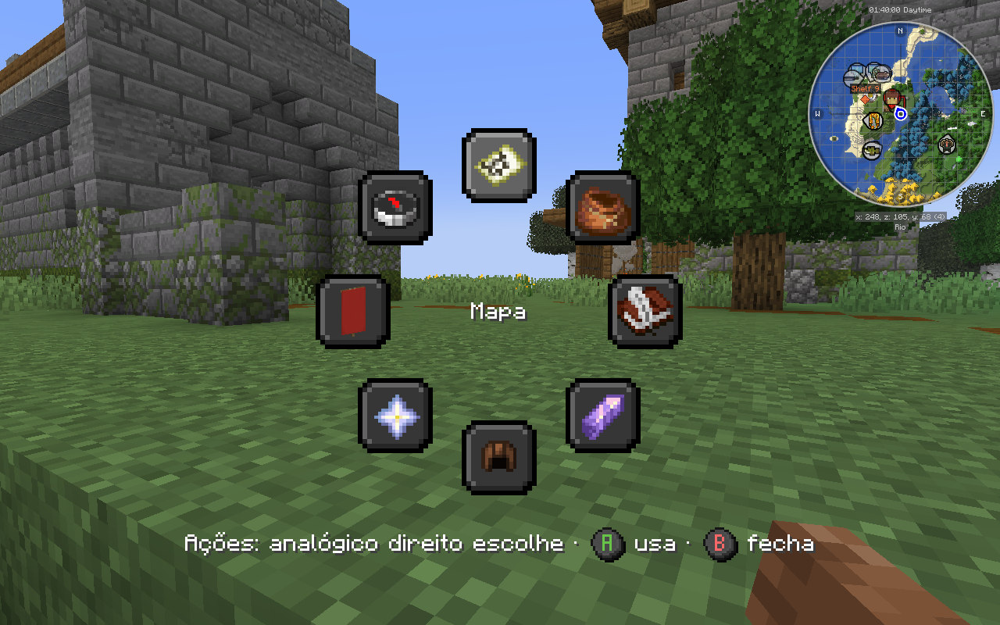

- **A roda de ações.** Segure o direcional para a esquerda e abre uma roda com o mapa, a mochila, as missões e mais.
  Incline o analógico para escolher e solte para usar.
- **Poder.** Toque no X para usar o poder da sua origem; segure para escolher outro numa roda.
- **O que posso fazer aqui?** Um toque curto no View abre uma ajuda com o que dá para fazer onde você está, a pé, num
  veículo ou montado.
- **Dicas na primeira vez.** Cada comando se explica uma vez, na primeira vez que importa, na sua língua.
- **Comandos de mods que funcionam no controle:** as armas do MCHeli disparam, e a tecla de uso do Iron's Spells
  funciona.
- Segurar View e Menu juntos continua livre para o Prism Console.
- Jogou com a versão de teste do controle? Suas teclas de Poder e de ajuda, os seus comandos do Controlify e as dicas
  que você já viu continuam com você.

## Plants & Zombies

*v2.0.0-alpha.2 e alpha.3: Plants & Zombies da 1.5 para a 1.5.2-neoforge.2, no cliente e no servidor*

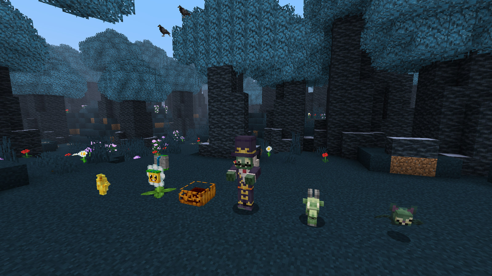

- **Plantas novas:** a Abóbora, e a Calêndula, que solta itens em vez de um pacote de sementes.
- **Zumbis novos:** a Cabra Zumbi, o Zumbi Morcego, que voa, e o Barão Von Morcego com o seu cajado.
- **Equipamento novo:** o Caixão, que vestido bloqueia ataques diretos de qualquer lado, e o Escudo de Porta, feito com
  um escudo e qualquer porta.
- **As invasões** podem trazer um chefe, com mais tipos de chefe, um som quando ele surge e um temporizador e um painel
  de ondas novos. O novo comando `/pz` tem `help` e `options` e, para operadores, `raid start`, `stop` e `wave_start`.
- E mais: cartas com anexos, portas e alçapões de Mioliga, o gnomo de jardim dourado, proteção melhor para a cabeça,
  bloqueio com jornal, o encantamento Lobbing da luva de jardinagem e munição para o disparador de tintas.
- Os personagens de Plants vs. Zombies têm os nomes oficiais em português.
- Os guardas das vilas enfrentam o Zumbi Morcego, a Cabra Zumbi e o Barão Von Morcego, e o Barão Von Morcego não pode
  ser preso numa Soul Cage.

## Vem aí no OreSpawn

O pack roda o OreSpawn 2.0.0-beta.15, o mesmo da v1.4.2. A próxima atualização do OreSpawn, a **beta.16**, já está
pronta e chega ao pack numa versão futura:

- **Armadura Moderna nova para os 14 conjuntos.** Peças em 3D com os detalhes de cada conjunto: a tiara e o manto de
  escamas da Rainha, a coroa, a gola e a capa do Guardião Real, as placas dorsais e as garras do Mobzilla, as asas e a
  gema central do Supremo, as orelhas e as garras do Olho de Tigre, os cristais do Cristal Rosa, as antenas e as asas
  dobradas da Escama de Mariposa, as barbatanas e as costuras brilhantes da Enguia de Lava, a crista e o leque de penas
  do Pavão. Texturas novas, ícones novos no inventário e armaduras de cavalo, lobo e cachorro combinando. Escolha
  Moderna ou Clássica na tela de Visual do OreSpawn (tecla O por padrão); a Clássica continua igual.
- **A carapaça do Metroide Gama** não tem mais um buraco no lado direito.

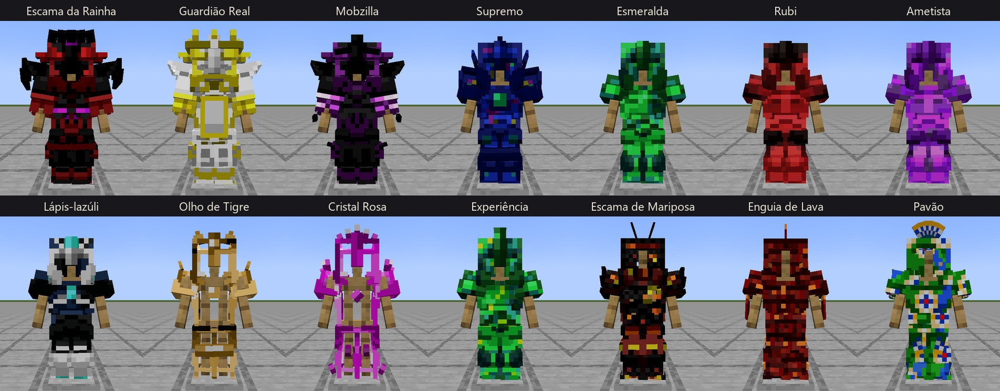

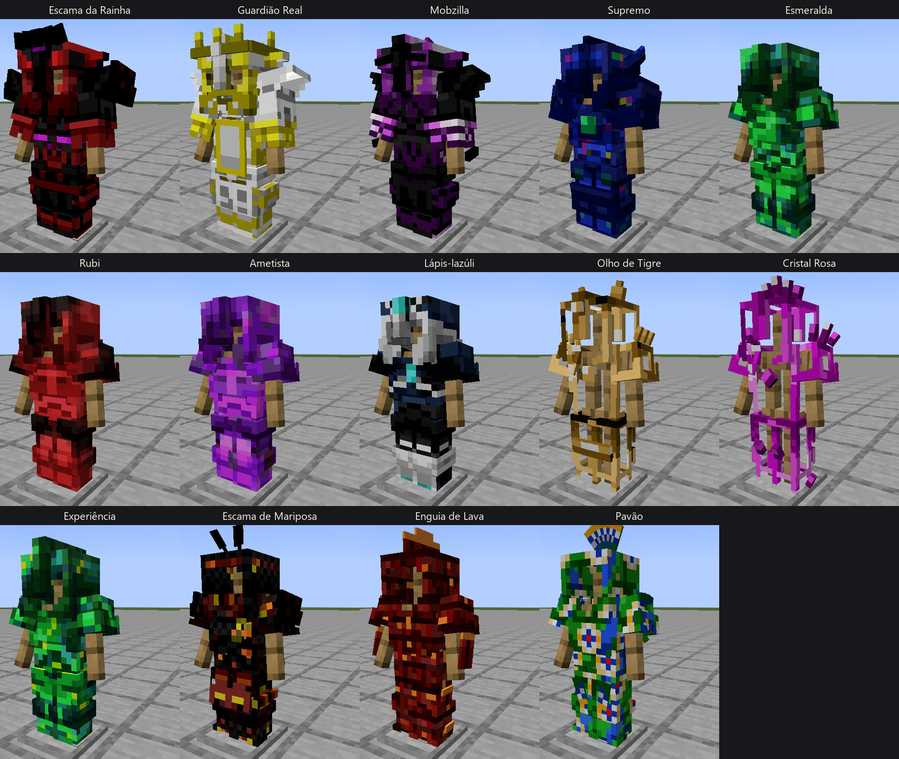

Notas completas: o [changelog do OreSpawn](https://github.com/CoolFreeze23/Orespawn/blob/master/CHANGELOG.md) (em
inglês).

## Mudanças no pack

**Removido**
- Randomizer: Complete Edition. A atualização move o jar para `mods-removed/`; nada é apagado.

**Equilíbrio**
- A Soul Cage recusa chefes.
- Quebrar minério de carvão não solta mais a poeira de carvão do HBM.
- O Umvuthi e o Escultor cobram preços mais justos.
- A Árvore Duplicadora não copia mais blocos.
- As ilhas que vagam andam na metade da velocidade.
- A Caixa de Pandora não gera mais o Wither, e o vazio dela tem de 6 a 10 blocos.
- Os bichos de estimação perto de você viajam junto pelos waystones.
- Os guardas das vilas também enfrentam os robôs do OreSpawn e os zumbis do Plants & Zombies.
- Virar uma criatura hostil no Walkers não faz mais todo monstro te deixar em paz.

**Correções**
- Colocar o boteco do Seu Zé não diz mais que não tem ninguém no balcão quando o Seu Zé, ou o Lobisomem dele
  na lua cheia, está lá.
- A armadilha de uma Arca Real não queima nem quebra mais o telhado; as explosões dela só ferem os jogadores por perto.
- O jogo não fecha mais no inventário criativo com o Refurbished Furniture.
- Nomes e subtítulos longos de região não saem mais da tela em escalas pequenas de interface.
- Uma instalação nova abre direto na tela de título; a escolha do narrador continua no menu de opções.
- O jogo não deixa mais de abrir por causa de pacote de recursos com caractere especial no nome, e o pacote Redstone
  Torch aparece uma vez só.
- O Jade não entrega mais o Mímico.
- O Ars Nouveau não põe mais o livro no seu inventário toda vez que você entra.
- O Fim da Jornada só conta um Dragão morto no End.
- O minimapa extra no canto sumiu.

**Textos**
- A frase da tela de título, "o trono está vazio", aparece no seu idioma, e o botão de idioma voltou.
- O Godzilla agora é Mobzilla, e o Simple Lucky Block é a Arca Lacrada.
- Muitos nomes em português foram corrigidos.

**Teclado e controle**
- O Controlify 3.0.1+lts entra no pack, no cliente.
- Instalações novas ganham um teclado sem conflitos: 106 teclas mudaram de lugar e 29 teclas de depuração e de
  configuração ficaram sem atalho, com o Poder no R e a roda de feitiços do Iron's Spells no Alt+G. As atualizações
  mantêm as teclas que você mesmo definiu.
- O agachar do HBM está desligado; o aviso "Aperte O" dele pedia uma tecla que nenhum controle tem.
- O JourneyMap não mostra mais a tela Sobre na primeira vez que você abre o mapa.

**Instalação e atualização**
- Uma instalação alfa é avisada quando a 2.0.0 completa sair, e não mostra aviso da v1.4.2.
- As atualizações movem para `mods-removed/` o que o pack substituiu, incluindo a versão de teste do controle, e
  deixam os mods extras que você colocou onde estão.
- Um pacote de recursos renomeado continua no mesmo lugar da sua lista.

**Sem mudança desde a v1.4.2:** OreSpawn 2.0.0-beta.15, Domestication Innovation 2.1.0, Origin Awakening 1.0.0, VRAM
Leak Fixes 1.0.0, OreSpawn Delight 0.1.0 e NeoForge 21.1.252. O pack tem 212
mods (168 no servidor) e 29 pacotes de recursos.

## Seus mundos

**Faça backup primeiro.** Copie a pasta `saves/` (ou a pasta do mundo do servidor) para um lugar seguro antes de abrir
um mundo numa alfa.

**Servidor e jogadores atualizam juntos.** O OreSpawn Integrations e o Plants & Zombies rodam dos dois lados, então um
cliente alfa não entra num servidor v1.4.x, nem o contrário. O servidor hub continua na v1.4.x.

**Só em terreno que você ainda não explorou:**
- A Prateleira 9 é colocada quando o mundo é criado. Num mundo mais antigo, um operador pode colocá-la com
  `/cc hatching_ground place`.
- O Pavilhão de Caça é colocado na primeira abertura de um mundo novo. Num mundo mais antigo, o quadro de segunda fica
  nas tendas de Caçador de Monstros e nos Balcões do Registro, ou um operador coloca um Pavilhão com
  `/cc hunt_lodge place`.
- O boteco do Seu Zé aparece em terreno novo.
- Os cemitérios do Plants & Zombies aparecem em terreno novo.

**No terreno que você já explorou, assim que ele carrega:**
- Sem o Randomizer, receitas, drops e baús nunca abertos voltam ao normal do Minecraft. Um baú do Lootr que você já
  abriu guarda o que te deu.
- Utopia para de gerar monstros em todo lugar, as Minas Reais perdem os Cavaleiros do Ender, os Ceifadores do Ender e a
  Mothra, e as ilhas que vagam param de aparecer nas Ilhas.
- As Folhas Perdidas começam a aparecer nos baús que você ainda não abriu.
- O Mobzilla e os Krakens das arenas e dos covis que você já achou começam a fazer a sesta na próxima vez que carregarem.

**Seu personagem:**
- Quem já estava no mundo ganha uma entrada atrasada no Livro de Eclosões, a Convocação pelo ar e uma Queda Retroativa.
- Os postos da corte chegam no seu próximo login, e o seu Processo abre na próxima visita ao Registro.
- Morcegos zumbis e seus ovos salvos num mundo da alpha.2 somem com a alpha.3, porque a criatura tem um id novo. Use um
  Zumbi Morcego no lugar.

## Problemas conhecidos

- Criar o primeiro mundo pode levar até cerca de um minuto num portátil, enquanto a Prateleira 9 e o Pavilhão de Caça
  procuram onde ficar.
- Um mundo sem terra adequada a até 192 blocos fica sem a Prateleira 9. Isso é raro.
- Um mundo sem terra adequada a 300–600 blocos fica sem o Pavilhão de Caça; o quadro de segunda fica nas tendas e nos
  balcões.
- Os Reais de recompensa ainda não têm limite; o teto semanal chega numa versão futura.
- Neste pack, o Curupira não quebra as tábuas do Distant Lands, e o Castor pode comê-las.
- Os bolsões de petróleo do HBM podem terminar retos na borda de um chunk em terreno novo (um aviso no log, nada mais).
- Se um operador define as origens de um jogador por comando em vez da tela de origem, esse jogador não toma dano até
  entrar de novo (comportamento do próprio Neo Origins).

## Downloads

Baixe na [versão v2.0.0-alpha.6](https://github.com/CoolFreeze23/CrazyCraft-5.0/releases/tag/v2.0.0-alpha.6).

- `CrazyCraft5-Client.zip`: o pack do cliente. Importe no Prism Launcher ou no MultiMC (Adicionar Instância, depois
  Importar) e reserve de 8 a 12 GB de RAM. A primeira abertura baixa os mods das páginas oficiais. O MCHeli ainda
  precisa ser baixado à mão.
- `CrazyCraft5-Server.zip`: os arquivos do servidor dedicado. Descompacte e dê dois cliques em
  `CrazyCraft Server Setup.bat` (Windows) ou rode `./startserver.sh` (Linux e macOS).
